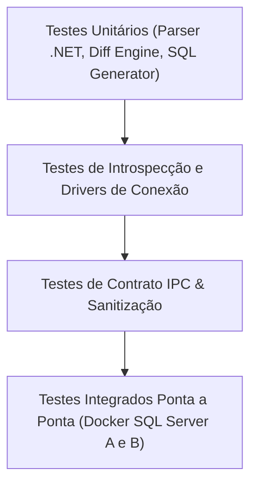

# SchemaLens — Estratégia de Testes

## 1. Pirâmide de Testes

## 2. Níveis de Teste
1. **Testes Unitários (Rust Puro)**:
   - Parser de Connection String: validação exaustiva de aliases, aspas, espaços, senhas com caracteres especiais.
   - Motor de Diff: algoritmos puros de pareamento com fixtures estáticas em memória. Determinismo e ordenação estável.
   - Gerador SQL: validação de syntax DDL, quoting (`QUOTENAME`), detecção de risco de perda de dados.
2. **Testes de Integração com Banco (Docker)**:
   - Dois containers SQL Server (`SchemaSource` porta 14331 e `SchemaTarget` porta 14332).
   - Teste real de queries em `sys.tables`, `sys.columns`, etc.
   - Prova de validação com credenciais inválidas e instâncias com banco inacessível.
3. **Testes de Contrato e IPC**:
   - Validação de correspondência entre tipos Rust e interfaces TypeScript do frontend.
4. **Testes de Segurança**:
   - Teste de redaction de logs com senhas dummy.
   - Verificação de escape contra SQL injection em identificadores maliciosos.
