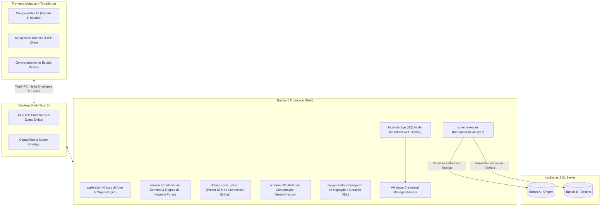
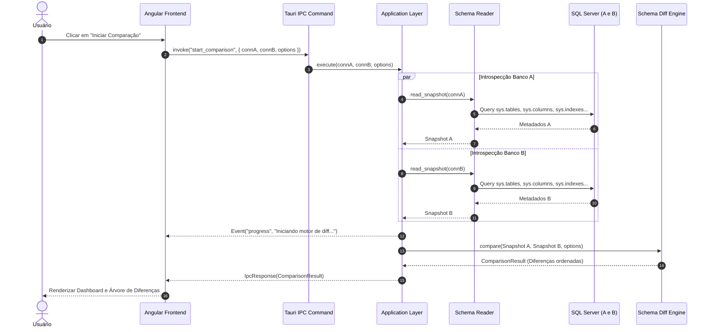

# SchemaLens — Arquitetura do Sistema

## 1. Visão Arquitetural Geral
O SchemaLens é construído como um aplicativo desktop modular utilizando **Tauri 2** como camada de runtime do SO Windows, um frontend reativo em **Angular 19/20** e um backend de alta performance estruturado como um monorepo multi-crates em **Rust**.

## 2. Divisão de Crates do Rust
1. **`domain`**:
   - Totalmente independente de frameworks, bibliotecas de banco de dados ou UI.
   - Contém structs puras: `SchemaSnapshot`, `TableMetadata`, `ColumnMetadata`, `IndexMetadata`, `SchemaDifference`, etc.
   - Enums para severidade, tipos de diferença e status de confiança.
2. **`dotnet_conn_parser`**:
   - Parser seguro para connection strings de formato .NET.
   - Normaliza aliases e valida opções de segurança.
3. **`schema-reader`**:
   - Executa consultas estruturadas às views `sys.*` do SQL Server via driver `tiberius`.
   - Constrói o `SchemaSnapshot` normalizado.
4. **`schema-diff`**:
   - Algoritmo de pareamento e comparação determinística de snapshots.
   - Ordenação canônica das diferenças e cálculo de severidade.
5. **`sql-generator`**:
   - Constrói o `MigrationPlan` a partir das diferenças elegíveis.
   - Emite scripts DDL comentados e com identificadores envolvidos com `QUOTENAME` (`[Schema].[Nome]`).
6. **`local-storage`**:
   - Persistência SQLite local para histórico de comparações e perfis.
   - Integração com a API do Windows Credential Manager.
7. **`application`**:
   - Casos de uso e orquestração entre leitor, comparador, gerador e armazenamento.
8. **`tauri-app`**:
   - Binário final Tauri 2, registro de comandos IPC e gerenciamento de ciclo de vida.

## 3. Diagrama de Sequência de Comparação

## 4. Política de Tratamento de Erros e Sanitização
- Toda exceção SQL interna ou de rede tem sua mensagem filtrada por uma camada de redaction antes de alcançar a UI.
- Nenhuma connection string com valor de `Password` ou `PWD` é exposta em logs de console ou respostas IPC.
